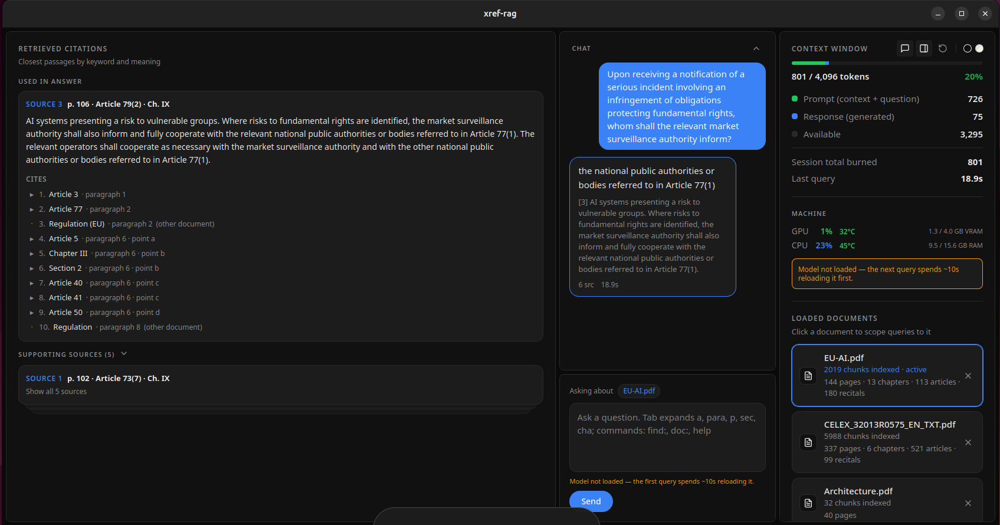

# xref-rag

Retrieval-Augmented Generation for densely cross-referenced corpora



Ask a question about a regulation such as the EU AI Act, and xref-rag answers with the exact article, paragraph and point it relies on, and shows which other provisions those passages refer to. Documents, embeddings and the language model all stay on your computer.

## Why

Legal and regulatory texts are long, content-rich, precise and full of references ("the bodies referred to in Article 77(1)"). Generic RAG retrieves the passages closest to the query's vector but fails to retrieve a provision hidden deep inside the document.

xref-rag is aware of the document's structure and ties every answer to numbered sources that you can then trace and read.

## Installation


### Desktop app (Windows and Linux)

1. Download the installer for your system from the [latest release](https://github.com/JayAlvn/xref-rag/releases/latest):
  - Windows: `xref-rag_<version>_x64-setup.exe`
  - Linux: `xref-rag_<version>_amd64.AppImage` or `.deb`
2. Install and open it. On first start, xref-rag offers to set up Ollama and download the language model (about 2 GB).
3. Add a document (PDF, DOCX or TXT) and ask a question.


### Docker

Runs the interface, the backend and the language model together. Requires [Docker](https://docs.docker.com/get-docker/) with Docker Compose.

```bash
git clone https://github.com/JayAlvn/xref-rag.git
cd xref-rag
docker compose up -d --build
docker compose exec ollama ollama pull llama3.2
```

Open [http://127.0.0.1:8080](http://127.0.0.1:8080). To stop it: `docker compose down` (your documents are kept).

The model runs on the CPU by default. With an NVIDIA GPU and the [NVIDIA Container Toolkit](https://docs.nvidia.com/datacenter/cloud-native/container-toolkit/latest/install-guide.html), start it with:

```bash
docker compose -f compose.yaml -f compose.gpu.yaml up -d --build
```

Prebuilt images: [xref-rag-backend](https://github.com/JayAlvn/xref-rag/pkgs/container/xref-rag-backend) ·[xref-rag-frontend](https://github.com/JayAlvn/xref-rag/pkgs/container/xref-rag-frontend)